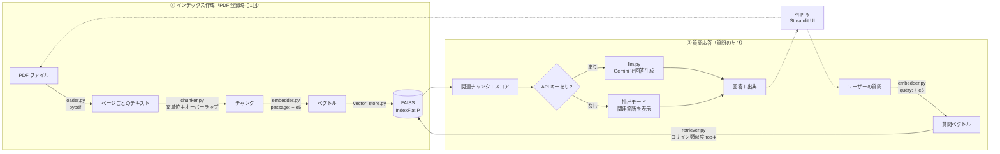

# 📄 PDF ドキュメント Q&A（RAG デモ）

PDF をアップロードして日本語で質問すると、文書の中から関連する箇所を検索し、
その内容だけを根拠に **出典（ファイル名・ページ番号）付き** で回答する Streamlit アプリです。

- 🔍 **検索（Retrieval）**: 多言語埋め込みモデル `multilingual-e5-small` ＋ FAISS
- ✍️ **生成（Generation）**: Google Gemini（公式 SDK `google-genai`）
- 💸 **API キー無しでも動作**: キーが無い場合は検索結果をそのまま表示する「抽出モード」で、完全無料で試せます
- 📎 **出典表示**: 回答ごとに参照したファイル名・ページ番号と、検索されたチャンク・類似度スコアを確認できます


<!-- スクリーンショットを差し替える場合は docs/screenshot.png を上書きしてください（scripts/take_screenshot.py で自動撮影できます） -->

---

## 目次

1. [機能](#機能)
2. [アーキテクチャ](#アーキテクチャ)
3. [RAG の仕組み（このアプリでの流れ）](#rag-の仕組みこのアプリでの流れ)
4. [セットアップ](#セットアップ)
5. [無料の Gemini API キーの取得方法](#無料の-gemini-api-キーの取得方法)
6. [使い方](#使い方)
7. [設計上の判断](#設計上の判断)
8. [テスト](#テスト)
9. [ディレクトリ構成](#ディレクトリ構成)
10. [今後の改善](#今後の改善)

---

## 機能

| 機能 | 説明 |
| --- | --- |
| PDF アップロード | 複数ファイルを同時に登録可能。サンプル PDF（架空の会社の就業規則・社内FAQ）も同梱 |
| チャット形式の Q&A | 会話履歴を保持し、質問ごとに検索→回答 |
| 出典表示 | 「ファイル名 p.ページ番号」を回答の下に表示 |
| 検索結果の可視化 | 取り出したチャンクの本文と類似度スコアを展開表示 |
| 2 つの動作モード | **生成モード**（Gemini が回答を作成）/ **抽出モード**（API キー不要・関連箇所を表示） |
| パラメータ調整 | サイドバーでチャンクサイズ・オーバーラップ・top-k・モデルを変更可能 |
| ハルシネーション対策 | 資料に無い内容は「わからない」と答えるようプロンプトで指示 |

## アーキテクチャ



## RAG の仕組み（このアプリでの流れ）

RAG（Retrieval-Augmented Generation ＝ 検索拡張生成）は、「LLM に答えさせる前に、
関係のある資料を検索して一緒に渡す」手法です。LLM が知らない社内文書についても、
資料に基づいた回答ができるようになります。

1. **PDF を読み込む**（`src/loader.py`）
   pypdf でページごとにテキストを取り出します。PDF 特有の「見た目の折り返しによる改行」や
   ページ番号だけの行を取り除き、ページ番号は出典表示のために保持します。
2. **チャンクに分割する**（`src/chunker.py`）
   長い文章をそのまま検索すると精度が落ちるため、約 200 文字の「チャンク」に分けます。
   日本語は単語の間にスペースが無いので **文字数** で長さを測り、「。」などの **文の区切りを優先** して分割します。
   チャンクの境目で文脈が切れないよう、前のチャンクの末尾を少し重ねます（オーバーラップ）。
3. **ベクトル化する**（`src/embedder.py`）
   各チャンクを `multilingual-e5-small` で 384 次元のベクトルに変換します。
   E5 の約束に従い、文書には `passage: `、質問には `query: ` を先頭に付けます。
4. **ベクトルストアに保存する**（`src/vector_store.py`）
   FAISS の `IndexFlatIP` に登録します。ベクトルを長さ 1 に正規化しているので、内積＝コサイン類似度です。
5. **質問に近いチャンクを検索する**（`src/retriever.py`）
   質問も同じモデルでベクトル化し、類似度の高い順に top-k 件のチャンクを取り出します。
6. **回答を生成する**（`src/llm.py`）
   取り出したチャンクに番号と出典を付けてプロンプトに入れ、Gemini に
   「この資料だけを根拠に答え、無ければ『わからない』と答える」よう指示します。
   API キーが無い場合は、上位のチャンクをそのまま回答として表示します（抽出モード）。

## セットアップ

前提: **Python 3.10 以上**（3.13 で動作確認済み）。初回起動時に埋め込みモデル（約 470MB）を自動ダウンロードします。

### Windows（PowerShell）

```powershell
git clone <このリポジトリのURL>
cd rag-doc-qa

python -m venv .venv
.\.venv\Scripts\Activate.ps1
# ※「スクリプトの実行が無効」と出たら、先に次を実行:
#   Set-ExecutionPolicy -Scope CurrentUser RemoteSigned

# （任意）GPU 不要な CPU 版 torch を先に入れるとダウンロードが軽くなります
pip install torch --index-url https://download.pytorch.org/whl/cpu
pip install -r requirements.txt

# （任意）Gemini を使う場合: .env を作ってキーを書く
Copy-Item .env.example .env
notepad .env

streamlit run app.py
```

### Mac / Linux

```bash
git clone <このリポジトリのURL>
cd rag-doc-qa

python3 -m venv .venv
source .venv/bin/activate

# （任意）CPU 版 torch を先に入れると軽くなります（Mac は不要）
pip install torch --index-url https://download.pytorch.org/whl/cpu
pip install -r requirements.txt

# （任意）Gemini を使う場合
cp .env.example .env
# .env を開いて GEMINI_API_KEY を設定

streamlit run app.py
```

ブラウザで http://localhost:8501 が開きます。

### API キーの渡し方（どれか1つ・すべて任意）

アプリは次の順番でキーを探します。キーをコードに直接書いたり、Git にコミットしたりしないでください。

1. 環境変数 `GEMINI_API_KEY`（`.env` ファイルでも可）
2. `.streamlit/secrets.toml`（`.streamlit/secrets.toml.example` をコピーして作成）
3. サイドバーのパスワード入力欄（その場限りで、どこにも保存されません）

どれも無い場合は **抽出モード** で動作します。

## 無料の Gemini API キーの取得方法

1. [Google AI Studio](https://aistudio.google.com/apikey) に Google アカウントでログイン
2. 「API キーを作成（Create API key）」をクリック
3. 表示されたキーをコピーし、`.env` の `GEMINI_API_KEY=` の後ろに貼り付け

無料枠（Free Tier）の範囲であれば料金はかかりません（通常はクレジットカードの登録も不要です）。
ただし無料枠では入力内容が Google のサービス改善に使われる場合があるため、**機密情報を含む PDF は使わない** でください。
レート制限などの最新情報は [公式の料金ページ](https://ai.google.dev/gemini-api/docs/pricing) を確認してください。

> **モデルについて（2026年10月時点）**
> デフォルトは無料枠で使える `gemini-3.5-flash-lite`（高速・低コスト）です。サイドバーで `gemini-3.8-flash` に切り替えられます。
> `gemini-2.5-flash` は現在「過去に利用実績のあるユーザーのみ」に提供が制限されているため、選択肢には残していますがデフォルトにはしていません。
> モデル名は `src/config.py` の `GEMINI_MODELS` で変更できます。

## 使い方

1. 「サンプル PDF を使う」にチェックが入った状態で **「📚 インデックスを作成」** を押す（自分の PDF をアップロードしても OK）
2. 画面下のチャット欄に質問を入力（例を下に記載）
3. 回答の下の「📎 出典」と「🔍 検索されたチャンク」で根拠を確認

サンプル PDF で試せる質問の例:

- 有給休暇は何日前までに申請する必要がありますか？
- リモートワークは週に何日までできますか？
- 退職するときはいつまでに伝えればいい？
- 生成AIを仕事で使ってもいいですか？
- 社員食堂のメニューを教えて（← 資料に無いので「わからない」になるはず）

画面なしでパイプラインだけ確認したい場合:

```bash
python scripts/demo_pipeline.py   # API キー不要。結果例は docs/demo_output.txt
```

## 設計上の判断

| 項目 | 選んだもの | 理由 |
| --- | --- | --- |
| UI | Streamlit | Python だけでチャット UI・ファイルアップロードを短いコードで作れ、プロトタイプに最適 |
| PDF 読み込み | pypdf | 純 Python で依存が少なく、Windows/Mac/Linux で同じように動く |
| チャンク分割 | 自作（文字数＋文境界＋オーバーラップ） | 日本語に合わせた分割を、ライブラリに頼らず中身を説明できる形で実装するため。ページをまたがないので出典ページが正確 |
| 埋め込み | `intfloat/multilingual-e5-small` | 無料・ローカル実行・日本語対応。約 470MB と軽く CPU でも十分速い（サンプル PDF のインデックス作成は数秒）。`query:` / `passage:` の接頭辞で質問と文書を区別 |
| ベクトルストア | **FAISS（IndexFlatIP）** | 下記参照 |
| LLM | Gemini（`google-genai` SDK） | 無料枠があり、公式の新しい SDK で数行で呼び出せる |
| フォールバック | 抽出モード | API キーが無い人・費用をかけたくない人でもすぐ試せるように |
| 温度（temperature） | 0.1 | 資料に忠実で安定した回答にするため低めに設定 |

### なぜ FAISS（numpy ではなく）を選んだか

- 今回のデータ量（数十〜数千チャンク）なら numpy の行列積でも十分速く、実装もほぼ同じです。
- それでも FAISS にしたのは、**実務の RAG で使われる定番ライブラリの使い方を示せる** ことと、
  データが増えたときに `IndexFlatIP`（総当たり・正確）から `IndexHNSWFlat` や `IndexIVFFlat`（近似・高速）に
  **1 行の変更で切り替えられる** 拡張性のためです。
- `IndexFlatIP` は近似を使わない総当たり検索なので、結果は numpy で計算した場合と同じ（正確）です。
- ベクトルストアは `vector_store.py` に閉じ込めているので、Chroma や pgvector などへの差し替えも他のファイルに影響しません。

### 知っておきたい限界

- **E5 の類似度スコアは 0.8〜0.9 付近に集中しやすい** 性質があります。そのため「スコアが○○以下なら無関係」という
  しきい値は決めにくく、本アプリでは「資料に無ければ『わからない』と答える」判断を LLM に任せています。
- 「給料」と「給与」のような言い換えでは、上位 1 件目に正解が来ないこともあります（top-k を 3〜5 にしておけばほぼ拾えます）。
  キーワード検索（BM25）との併用やリランキングで改善できます（今後の改善を参照）。
- スキャン画像だけの PDF（文字情報が無いもの）は OCR が必要なため未対応です。
- インデックスはメモリ上にのみ保持し、ブラウザのセッションが切れると消えます（デモとしてシンプルさを優先）。

## テスト

```bash
python -m pytest -v
```

- `tests/test_chunker.py`: 文分割、サイズ上限、オーバーラップ、長文の強制分割、ページ情報の保持、PDF テキスト整形
- `tests/test_retriever.py`: 文字の出現回数で作る **軽量な偽の埋め込み（FakeEmbedder）** を使い、モデルをダウンロードせずに検索の順位・スコア・top-k を検証（1 秒未満で完了）
- `tests/test_llm.py`: API を呼ばない部分（プロンプト作成・抽出モードの出力）

## ディレクトリ構成

```
rag-doc-qa/
├── app.py                     # Streamlit アプリ本体（UI）
├── src/
│   ├── config.py              # モデル名・デフォルト値などの設定
│   ├── loader.py              # PDF → ページごとのテキスト
│   ├── chunker.py             # テキスト → チャンク（日本語向け）
│   ├── embedder.py            # テキスト → ベクトル（multilingual-e5）
│   ├── vector_store.py        # FAISS によるベクトル保存・検索
│   ├── retriever.py           # 埋め込み＋ベクトルストアをまとめた検索器
│   └── llm.py                 # Gemini での回答生成・抽出モード
├── tests/                     # pytest（偽の埋め込みで高速）
├── scripts/
│   ├── make_sample_pdf.py     # サンプル PDF の生成（reportlab）
│   ├── demo_pipeline.py       # 画面なしでパイプラインを確認
│   └── take_screenshot.py     # README 用スクリーンショットの自動撮影
├── sample_docs/
│   └── sample_company_rules.pdf  # 架空企業の就業規則・FAQ（公開可）
├── docs/
│   ├── EXPLAIN.md             # 各モジュールの解説と想定質問集
│   ├── demo_output.txt        # demo_pipeline.py の実行結果
│   └── screenshot.png
├── .streamlit/
│   ├── config.toml            # Streamlit の設定（秘密情報なし）
│   └── secrets.toml.example   # secrets.toml のひな形
├── .env.example               # .env のひな形
├── requirements.txt
└── requirements-dev.txt       # スクリーンショット撮影用（playwright）
```

## 今後の改善

- **FastAPI で API 化**: `src/` のパイプラインはUIに依存しないので、`POST /index`・`POST /ask` のような REST API にそのまま載せられます。フロントエンドを React などに分離することも可能。
- **Azure OpenAI / Amazon Bedrock 対応**: `llm.py` に同じ形の関数（`generate_answer`）を追加し、設定で切り替えられるようにする。企業利用ではデータの取り扱い面でこちらが選ばれることが多い。
- **評価の仕組み（RAGAS など）**: 質問と正解のセットを用意し、検索の正解率（Recall@k）や回答の忠実性（Faithfulness）を数値で測る。チャンクサイズやモデルを変えたときの効果を客観的に比べられる。
- **ハイブリッド検索（BM25 ＋ ベクトル検索）**: 固有名詞・数字・条文番号などはキーワード検索が得意。日本語は形態素解析（SudachiPy など）や文字 n-gram でトークン化して BM25 を作り、ベクトル検索の結果と統合（RRF など）する。
- **リランキング**: 多めに（例: 20 件）取り出した候補を、クロスエンコーダ（例: 多言語対応の reranker モデル）で並べ替えてから LLM に渡し、精度を上げる。
- その他: インデックスのディスク保存、OCR 対応、回答のストリーミング表示、会話の文脈を踏まえた質問の書き換え。

## ライセンス・データについて

同梱のサンプル PDF は、本リポジトリ用に作成した **架空の企業** の文書です。実在の企業・団体とは関係ありません。
