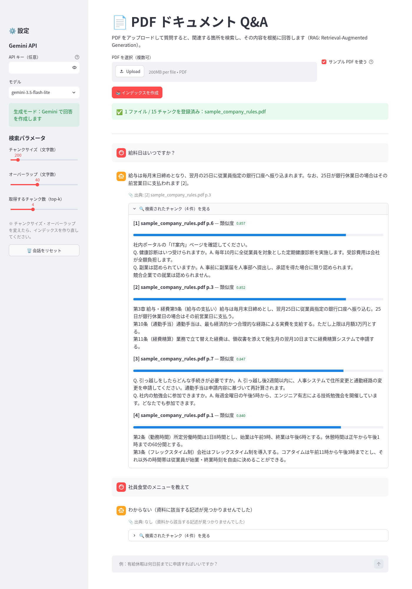
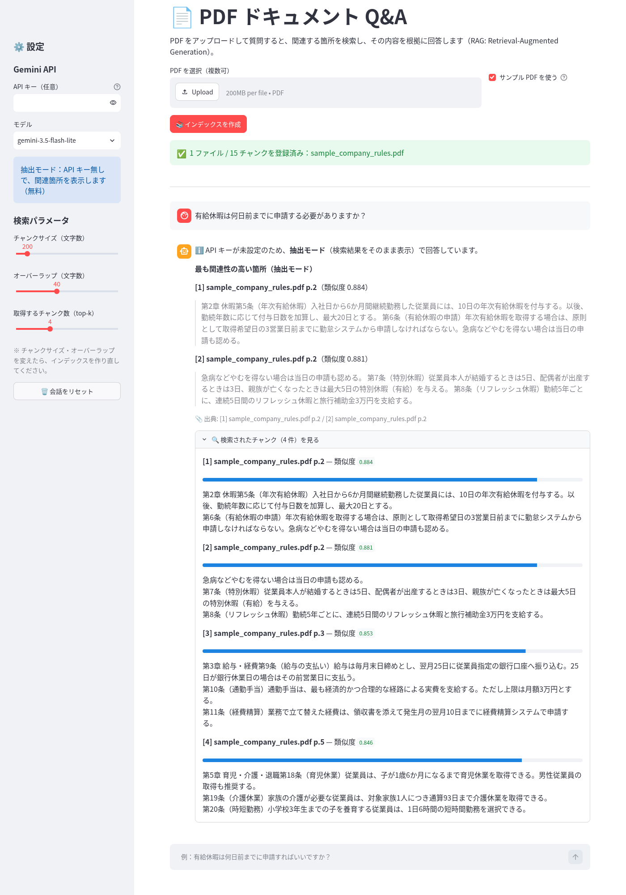
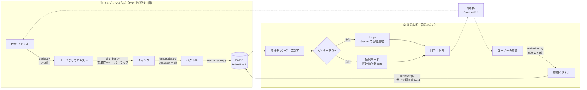

# 📄 PDF ドキュメント Q&A（RAG デモ）

PDF をアップロードして日本語で質問すると、文書の中から関連する箇所を検索し、
その内容だけを根拠に **出典（ファイル名・ページ番号）付き** で回答する Streamlit アプリです。

- 🔍 **検索（Retrieval）**: 多言語埋め込みモデル `multilingual-e5-small` ＋ FAISS
- ✍️ **生成（Generation）**: Google Gemini（公式 SDK `google-genai`）
- 💸 **API キー無しでも動作**: キーが無い場合は検索結果をそのまま表示する「抽出モード」で、完全無料で試せます
- 📎 **出典表示**: 回答ごとに参照したファイル名・ページ番号と、検索されたチャンク・類似度スコアを確認できます

**生成モード（Gemini `gemini-3.5-flash-lite`）の実際の画面**: 回答に出典番号が付き、資料に無い質問には「わからない」と答えています。



<details>
<summary>API キー無し（抽出モード）の画面</summary>



</details>

> ✅ **動作確認済み**: サンプル PDF に対して Gemini（`gemini-3.5-flash-lite`）で実際に回答を生成し、
> 資料にある 6 問はすべて正しい条文を引用して回答、資料に無い 1 問（社員食堂）は「わからない」と回答することを確認しました。
> 結果は [docs/demo_output_gemini.txt](docs/demo_output_gemini.txt) にあります（2026年10月）。

<!-- スクリーンショットは scripts/take_screenshot.py で自動撮影できます -->

---

## 目次

1. [機能](#機能)
2. [アーキテクチャ](#アーキテクチャ)
3. [RAG の仕組み（このアプリでの流れ）](#rag-の仕組みこのアプリでの流れ)
4. [セットアップ](#セットアップ)
5. [無料の Gemini API キーの取得方法](#無料の-gemini-api-キーの取得方法)
6. [使い方](#使い方)
7. [設計上の判断](#設計上の判断)
8. [評価](#評価)
9. [テスト](#テスト)
10. [ディレクトリ構成](#ディレクトリ構成)
11. [今後の改善](#今後の改善)

---

## 機能

| 機能 | 説明 |
| --- | --- |
| PDF アップロード | 複数ファイルを同時に登録可能。サンプル PDF（架空の会社の就業規則・社内FAQ、11ページ）も同梱 |
| チャット形式の Q&A | 会話履歴を保持し、質問ごとに検索→回答 |
| 出典表示 | 回答が実際に参照した資料（[1] などの番号）だけを「ファイル名 p.ページ番号」で表示。「わからない」のときは出典なし |
| 検索結果の可視化 | 取り出したチャンクの本文と類似度スコアを展開表示 |
| 2 つの動作モード | **生成モード**（Gemini が回答を作成）/ **抽出モード**（API キー不要・関連箇所を表示） |
| パラメータ調整 | サイドバーでチャンクサイズ・オーバーラップ・top-k・検索方式・モデルを変更可能 |
| ハルシネーション対策 | 資料に無い内容は「わからない」と答えるようプロンプトで指示 |
| 評価スクリプト | 検索精度（Hit@k・MRR）・回答品質（LLM 採点）・費用・応答時間を数字で計測（[評価](#評価)） |

## アーキテクチャ



## RAG の仕組み（このアプリでの流れ）

RAG（Retrieval-Augmented Generation ＝ 検索拡張生成）は、「LLM に答えさせる前に、
関係のある資料を検索して一緒に渡す」手法です。LLM が知らない社内文書についても、
資料に基づいた回答ができるようになります。

1. **PDF を読み込む**（`src/loader.py`）
   pypdf でページごとにテキストを取り出します。PDF 特有の「見た目の折り返しによる改行」や
   ページ番号だけの行を取り除き、ページ番号は出典表示のために保持します。
2. **チャンクに分割する**（`src/chunker.py`）
   長い文章をそのまま検索すると精度が落ちるため、約 200 文字の「チャンク」に分けます。
   日本語は単語の間にスペースが無いので **文字数** で長さを測り、「。」などの **文の区切りを優先** して分割します。
   チャンクの境目で文脈が切れないよう、前のチャンクの末尾を少し重ねます（オーバーラップ）。
3. **ベクトル化する**（`src/embedder.py`）
   各チャンクを `multilingual-e5-small` で 384 次元のベクトルに変換します。
   E5 の約束に従い、文書には `passage: `、質問には `query: ` を先頭に付けます。
4. **ベクトルストアに保存する**（`src/vector_store.py`）
   FAISS の `IndexFlatIP` に登録します。ベクトルを長さ 1 に正規化しているので、内積＝コサイン類似度です。
5. **質問に近いチャンクを検索する**（`src/retriever.py`）
   質問も同じモデルでベクトル化し、類似度の高い順に top-k 件のチャンクを取り出します。
6. **回答を生成する**（`src/llm.py`）
   取り出したチャンクに番号と出典を付けてプロンプトに入れ、Gemini に
   「この資料だけを根拠に答え、無ければ『わからない』と答える」よう指示します。
   API キーが無い場合は、上位のチャンクをそのまま回答として表示します（抽出モード）。

## セットアップ

前提: **Python 3.10 以上**（3.13 で動作確認済み）。初回起動時に埋め込みモデル（約 470MB）を自動ダウンロードします。

### Windows（PowerShell）

```powershell
git clone <このリポジトリのURL>
cd rag-doc-qa

python -m venv .venv
.\.venv\Scripts\Activate.ps1
# ※「スクリプトの実行が無効」と出たら、先に次を実行:
#   Set-ExecutionPolicy -Scope CurrentUser RemoteSigned

# （任意）GPU 不要な CPU 版 torch を先に入れるとダウンロードが軽くなります
pip install torch --index-url https://download.pytorch.org/whl/cpu
pip install -r requirements.txt

# （任意）Gemini を使う場合: .env を作ってキーを書く
Copy-Item .env.example .env
notepad .env

streamlit run app.py
```

### Mac / Linux

```bash
git clone <このリポジトリのURL>
cd rag-doc-qa

python3 -m venv .venv
source .venv/bin/activate

# （任意）CPU 版 torch を先に入れると軽くなります（Mac は不要）
pip install torch --index-url https://download.pytorch.org/whl/cpu
pip install -r requirements.txt

# （任意）Gemini を使う場合
cp .env.example .env
# .env を開いて GEMINI_API_KEY を設定

streamlit run app.py
```

ブラウザで http://localhost:8501 が開きます。

### API キーの渡し方（どれか1つ・すべて任意）

アプリは次の順番でキーを探します。キーをコードに直接書いたり、Git にコミットしたりしないでください。

1. 環境変数 `GEMINI_API_KEY`（`.env` ファイルでも可）
2. `.streamlit/secrets.toml`（`.streamlit/secrets.toml.example` をコピーして作成）
3. サイドバーのパスワード入力欄（その場限りで、どこにも保存されません）

どれも無い場合は **抽出モード** で動作します。

## 無料の Gemini API キーの取得方法

1. [Google AI Studio](https://aistudio.google.com/apikey) に Google アカウントでログイン
2. 「API キーを作成（Create API key）」をクリック
3. 表示されたキーをコピーし、`.env` の `GEMINI_API_KEY=` の後ろに貼り付け

無料枠（Free Tier）の範囲であれば料金はかかりません（通常はクレジットカードの登録も不要です）。
ただし無料枠では入力内容が Google のサービス改善に使われる場合があるため、**機密情報を含む PDF は使わない** でください。
レート制限などの最新情報は [公式の料金ページ](https://ai.google.dev/gemini-api/docs/pricing) を確認してください。

> **モデルについて（2026年10月時点）**
> デフォルトは無料枠で使える `gemini-3.5-flash-lite`（高速・低コスト）です。サイドバーで `gemini-3.8-flash` に切り替えられます。
> `gemini-2.5-flash` は現在「過去に利用実績のあるユーザーのみ」に提供が制限されているため、選択肢には残していますがデフォルトにはしていません。
> モデル名は `src/config.py` の `GEMINI_MODELS` で変更できます。

## 使い方

1. 「サンプル PDF を使う」にチェックが入った状態で **「📚 インデックスを作成」** を押す（自分の PDF をアップロードしても OK）
2. 画面下のチャット欄に質問を入力（例を下に記載）
3. 回答の下の「📎 出典」と「🔍 検索されたチャンク」で根拠を確認

サンプル PDF で試せる質問の例:

- 有給休暇は何日前までに申請する必要がありますか？
- リモートワークは週に何日までできますか？
- 退職するときはいつまでに伝えればいい？
- 生成AIを仕事で使ってもいいですか？
- 社員食堂のメニューを教えて（← 資料に無いので「わからない」になるはず）

画面なしでパイプラインだけ確認したい場合:

```bash
python scripts/demo_pipeline.py   # 検索のみ（API キー不要）。結果例は docs/demo_output.txt
python scripts/demo_gemini.py     # 検索＋Gemini で回答生成（要 GEMINI_API_KEY）。結果例は docs/demo_output_gemini.txt
```

## 設計上の判断

| 項目 | 選んだもの | 理由 |
| --- | --- | --- |
| UI | Streamlit | Python だけでチャット UI・ファイルアップロードを短いコードで作れ、プロトタイプに最適 |
| PDF 読み込み | pypdf | 純 Python で依存が少なく、Windows/Mac/Linux で同じように動く |
| チャンク分割 | 自作（文字数＋文境界＋オーバーラップ） | 日本語に合わせた分割を、ライブラリに頼らず中身を説明できる形で実装するため。ページをまたがないので出典ページが正確 |
| 埋め込み | `intfloat/multilingual-e5-small` | 無料・ローカル実行・日本語対応。約 470MB と軽く CPU でも十分速い（サンプル PDF のインデックス作成は数秒）。`query:` / `passage:` の接頭辞で質問と文書を区別 |
| ベクトルストア | **FAISS（IndexFlatIP）** | 下記参照 |
| LLM | Gemini（`google-genai` SDK） | 無料枠があり、公式の新しい SDK で数行で呼び出せる |
| フォールバック | 抽出モード | API キーが無い人・費用をかけたくない人でもすぐ試せるように |
| 温度（temperature） | 0.1 | 資料に忠実で安定した回答にするため低めに設定 |

### なぜ FAISS（numpy ではなく）を選んだか

- 今回のデータ量（数十〜数千チャンク）なら numpy の行列積でも十分速く、実装もほぼ同じです。
- それでも FAISS にしたのは、**実務の RAG で使われる定番ライブラリの使い方を示せる** ことと、
  データが増えたときに `IndexFlatIP`（総当たり・正確）から `IndexHNSWFlat` や `IndexIVFFlat`（近似・高速）に
  **1 行の変更で切り替えられる** 拡張性のためです。
- `IndexFlatIP` は近似を使わない総当たり検索なので、結果は numpy で計算した場合と同じ（正確）です。
- ベクトルストアは `vector_store.py` に閉じ込めているので、Chroma や pgvector などへの差し替えも他のファイルに影響しません。

### 知っておきたい限界

- **E5 の類似度スコアは 0.8〜0.9 付近に集中しやすい** 性質があります。そのため「スコアが○○以下なら無関係」という
  しきい値は決めにくく、本アプリでは「資料に無ければ『わからない』と答える」判断を LLM に任せています。
- 「給料」と「給与」のような言い換えでは、上位 1 件目に正解が来ないこともあります（top-k を 3〜5 にしておけばほぼ拾えます）。
  キーワード検索（BM25）との併用やリランキングで改善できます（今後の改善を参照）。
- スキャン画像だけの PDF（文字情報が無いもの）は OCR が必要なため未対応です。
- インデックスはメモリ上にのみ保持し、ブラウザのセッションが切れると消えます（デモとしてシンプルさを優先）。

## 評価

「なんとなく動く」ではなく、**検索精度・回答品質・費用・応答時間を数字で測れる** ようにしています。
指標の意味・採点方法・限界の詳しい説明は [docs/EVAL.md](docs/EVAL.md) を参照してください。

### 方法

- **評価データ**: サンプル PDF（11ページ）に対する 30 問（[eval/questions.jsonl](eval/questions.jsonl)）。
  資料と違う言葉で聞く **言い換え質問 13 問**（給料↔給与、ボーナス↔賞与、在宅勤務↔リモートワーク など）、
  似た記述が複数ある紛らわしい質問、**資料に答えが無い質問 4 問**（有給の買い取り・退職金など、話題は近いが記載が無いもの）を含みます。
  各問に正解の根拠（ページ＋キーワード）と模範解答を付けています。
- **検索**: 正解の根拠を含むチャンクが何位に来たかから、Hit@1 / Hit@3 / Recall@4 / MRR を計算（API キー不要）。
- **回答品質**: 回答モデルとは別の LLM（`gemini-3.1-flash-lite`）が模範解答と比べて 0/1 で採点（LLM-as-a-judge）。
  資料に無い質問では「わからない」と答えられたか（正しく拒否）を測定。
- **費用・速度**: API の usage metadata のトークン数 × [公式料金](https://ai.google.dev/gemini-api/docs/pricing)（2026-10-21 確認）で費用を計算し、
  応答時間の p50 / p95 を記録。

```bash
python eval/run_eval.py --skip-generation --chunk-sizes 150 200 300 400   # 検索精度のみ（無料）
python eval/run_eval.py --models gemini-3.5-flash-lite gemini-3.1-flash-lite  # 回答品質・費用・速度も（要 API キー）
```

### ベースライン結果（2026-10-21、密ベクトル検索・e5-small・top-k=4）

全結果: [eval/results/20261021-165133.md](eval/results/20261021-165133.md)

**検索精度**（回答可能な 26 問）

| チャンクサイズ | チャンク数 | Hit@1 | Hit@3 | Recall@4 | MRR | 言い換え質問の Hit@3 |
| ---: | ---: | ---: | ---: | ---: | ---: | ---: |
| 150 | 34 | 73.1% | 96.2% | 96.2% | 0.847 | 92.3% |
| **200（採用）** | 23 | **73.1%** | **96.2%** | **100.0%** | **0.856** | 92.3% |
| 300 | 18 | 65.4% | 84.6% | 84.6% | 0.771 | 69.2% |
| 400 | 11 | 73.1% | 92.3% | 96.2% | 0.817 | 92.3% |

**回答品質・費用・速度**（30 問、検索は dense / 200 文字）

| モデル | 正答率（回答可能 26 問） | 正しく拒否（回答不能 4 問） | 平均トークン（入力 / 出力） | 費用 / 1000 問（無料枠 / 有料枠換算） | 応答 p50 / p95 |
| --- | ---: | ---: | ---: | ---: | ---: |
| gemini-3.5-flash-lite（デフォルト） | 100%（26/26） | 100%（4/4） | 649 / 22 | $0 / $0.25 | 0.56s / 0.72s |
| gemini-3.1-flash-lite | 100%（26/26） | 100%（4/4） | 649 / 20 | $0 / $0.19 | 1.08s / 7.83s |

### 結果から分かったこと

- **チャンクサイズ 200 文字が最もバランスが良い**。300 文字では言い換え質問の Hit@3 が 92% → 69% に下がった
  （1 チャンクに複数の条文が混ざり、ベクトルの意味がぼやけるため）。
- **改善の余地は「1 位の精度」**。Hit@3 は 96% だが Hit@1 は 73% で、正解が 2〜4 位に来ることが多い。
  上位 4 件を LLM に渡しているので今は回答に影響していないが、渡す件数を減らして費用を下げるには Hit@1 の改善が必要。
- **回答品質はこのデータセットでは上限に達している**（両モデルとも 30/30）。今のデータセットでは、モデルの差は正答率ではなく費用と速度にしか出ていない。
  より難しい質問（複数箇所をまたぐ質問、計算が必要な質問など）を追加すれば、差が出る可能性がある。
- **限界**: 30 問は少ない（1 問で約 4 ポイント変わる）。データセットも採点も、作者 1 人と LLM 1 つによるもの。
  `gemini-3.1-flash-lite` の行は、採点モデルと同じモデルなので自己選好バイアスの可能性がある。
  上位モデル（`gemini-3.8-flash`）との比較も試したが、評価時に高負荷（503）で応答が得られず、`gemini-3.6-flash` は無料枠の 1 日上限（20 回）に達したため、比較できなかった。

### 次のステップ: ハイブリッド検索

次は **BM25（キーワード検索）とベクトル検索を組み合わせたハイブリッド検索** を実装し、同じ評価データで Hit@1・MRR が改善するかを測ります。
検索方式は差し替えられる設計（`create_retriever("dense" | "hybrid")`）にしてあり、`src/bm25.py` に実装する関数の仕様とテスト
（`python -m pytest -m exercise`）を用意済みです。

## テスト

```bash
python -m pytest -v
```

- `tests/test_chunker.py`: 文分割、サイズ上限、オーバーラップ、長文の強制分割、ページ情報の保持、PDF テキスト整形
- `tests/test_retriever.py`: 文字の出現回数で作る **軽量な偽の埋め込み（FakeEmbedder）** を使い、モデルをダウンロードせずに検索の順位・スコア・top-k を検証（1 秒未満で完了）
- `tests/test_llm.py`: API を呼ばない部分（プロンプト作成・抽出モードの出力・回答中の参照番号の抽出・「わからない」の判定）。偽の LLM（FakeLLM）で生成処理も確認
- `tests/test_eval_metrics.py`: 評価指標（Hit@k・Recall@k・MRR・パーセンタイル）、費用計算、採点結果の読み取り
- `tests/test_bm25_exercise.py`: ハイブリッド検索の課題用テスト。`@pytest.mark.exercise` 付きで通常の実行からは除外（`python -m pytest -m exercise` で実行）

## ディレクトリ構成

```
rag-doc-qa/
├── app.py                     # Streamlit アプリ本体（UI）
├── src/
│   ├── config.py              # モデル名・デフォルト値などの設定
│   ├── loader.py              # PDF → ページごとのテキスト
│   ├── chunker.py             # テキスト → チャンク（日本語向け）
│   ├── embedder.py            # テキスト → ベクトル（multilingual-e5）
│   ├── vector_store.py        # FAISS によるベクトル保存・検索
│   ├── retriever.py           # 検索器（Retriever プロトコル・DenseRetriever・create_retriever）
│   ├── bm25.py                # BM25 ハイブリッド検索（課題：未実装のスタブ）
│   ├── llm.py                 # プロンプト作成・回答生成・抽出モード
│   └── llm_client.py          # LLM 呼び出し（LLMClient プロトコル・GeminiClient）
├── eval/
│   ├── questions.jsonl        # 評価データ（30 問）
│   ├── run_eval.py            # 評価スクリプト（検索・回答品質・費用・速度）
│   ├── metrics.py             # Hit@k・Recall@k・MRR などの指標
│   ├── judge.py               # LLM-as-a-judge（採点プロンプト）
│   ├── pricing.py             # モデルの料金表（出典・確認日付き）
│   └── results/               # 評価結果（Markdown と JSON）
├── tests/                     # pytest（偽の埋め込み・偽の LLM で高速）
├── scripts/
│   ├── make_sample_pdf.py     # サンプル PDF の生成（reportlab）
│   ├── demo_pipeline.py       # 画面なしで検索までを確認（キー不要）
│   ├── demo_gemini.py         # 画面なしで Gemini の回答生成まで確認
│   └── take_screenshot.py     # README 用スクリーンショットの自動撮影
├── sample_docs/
│   └── sample_company_rules.pdf  # 架空企業の就業規則・FAQ（公開可）
├── docs/
│   ├── EXPLAIN.md             # 各モジュールの解説と想定質問集
│   ├── EVAL.md                # 評価の解説（指標・採点・費用）と想定質問集
│   ├── demo_output.txt        # demo_pipeline.py の実行結果
│   ├── demo_output_gemini.txt # demo_gemini.py の実行結果
│   ├── screenshot.png         # 生成モードの画面
│   └── screenshot_extractive.png  # 抽出モードの画面
├── .streamlit/
│   ├── config.toml            # Streamlit の設定（秘密情報なし）
│   └── secrets.toml.example   # secrets.toml のひな形
├── .env.example               # .env のひな形
├── requirements.txt
└── requirements-dev.txt       # スクリーンショット撮影用（playwright）
```

## 今後の改善

- **FastAPI で API 化**: `src/` のパイプラインはUIに依存しないので、`POST /index`・`POST /ask` のような REST API にそのまま載せられます。フロントエンドを React などに分離することも可能。
- **Azure OpenAI / Amazon Bedrock 対応**: LLM の呼び出しは `src/llm_client.py` の `LLMClient` プロトコルに分離済み。同じ `generate()` を持つ `AzureOpenAIClient` / `BedrockClient` を追加すれば、プロンプトやアプリ側は変えずに切り替えられる。企業利用ではデータの取り扱い面でこちらが選ばれることが多い。
- **評価の拡充（RAGAS など）**: 自作の評価（[評価](#評価)）に加え、回答の忠実性（Faithfulness）など観点別の指標を追加する。質問数を増やし、一部は人手で採点して LLM 採点との一致率も確認する。
- **ハイブリッド検索（BM25 ＋ ベクトル検索）**: 次に取り組む改善（`src/bm25.py`）。固有名詞・数字・条文番号などはキーワード検索が得意。日本語は文字 n-gram でトークン化して BM25 を作り、ベクトル検索の結果と RRF で統合する。
- **リランキング**: 多めに（例: 20 件）取り出した候補を、クロスエンコーダ（例: 多言語対応の reranker モデル）で並べ替えてから LLM に渡し、精度を上げる。
- その他: インデックスのディスク保存、OCR 対応、回答のストリーミング表示、会話の文脈を踏まえた質問の書き換え。

## ライセンス・データについて

同梱のサンプル PDF は、本リポジトリ用に作成した **架空の企業** の文書です。実在の企業・団体とは関係ありません。
